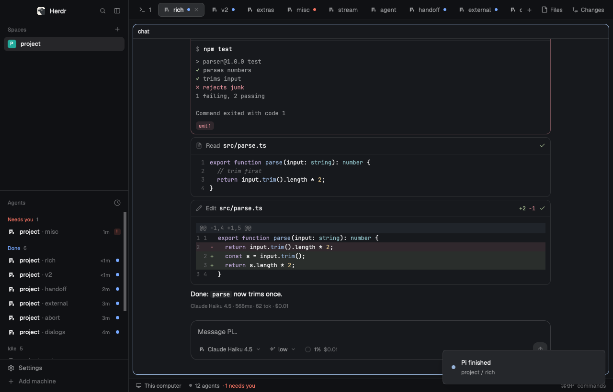
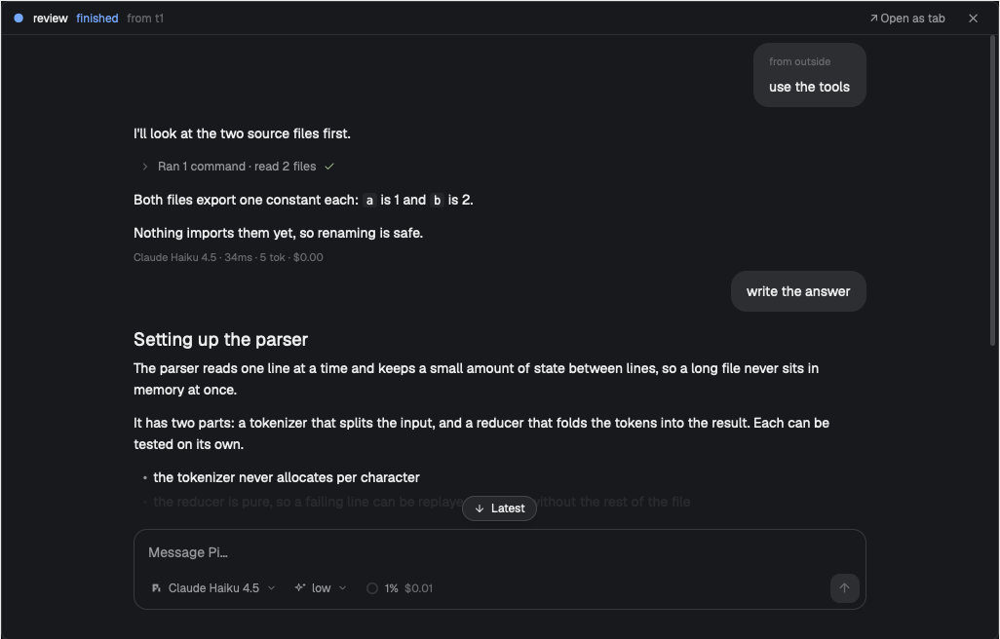
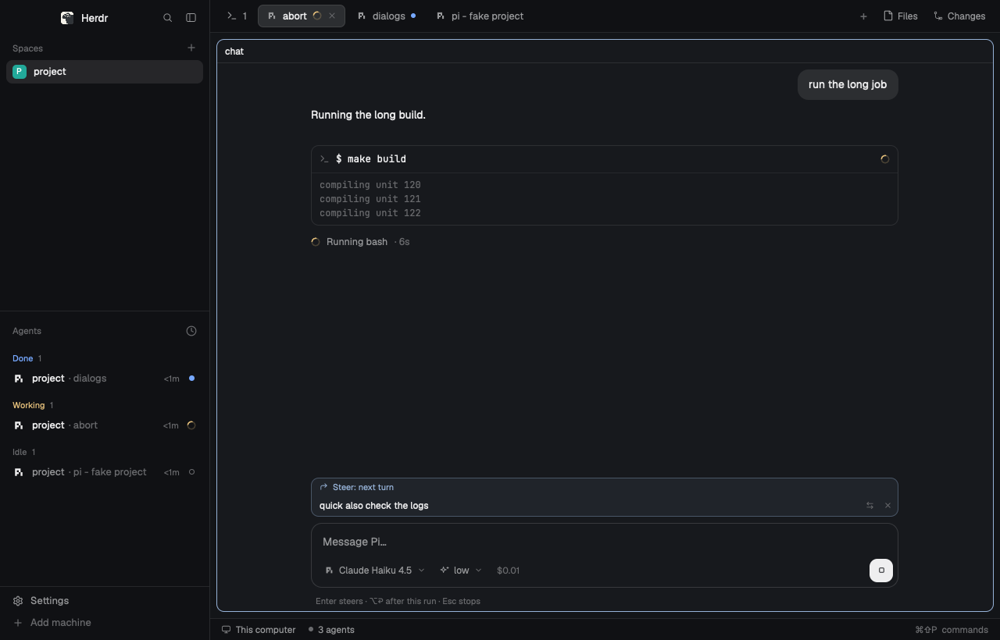

# herdr-chat

[](https://github.com/ChmaraX/herdr-chat/actions/workflows/ci.yml)
[](https://github.com/ChmaraX/herdr-chat/releases/latest)
[](LICENSE)

<p align="center">
  <a href="#install">install</a> · <a href="#using-it">using it</a> · <a href="#keys">keys</a> · <a href="#known-limits">limits</a> · <a href="#how-it-works">how it works</a> · <a href="https://github.com/ChmaraX/herdr-chat/releases">releases</a>
</p>

A native chat for Pi, Claude Code and Codex inside the
[Herdr](https://herdr.dev) desktop app. Streaming markdown, code and diagrams,
tool cards with diffs, approvals, and a model picker, in place of a terminal
UI. Each agent is the CLI you already use, with your login, settings,
extensions, skills and sessions.

<!-- video: a short GIF or video of a chat goes here -->



| A sub-agent's chat, opened from the agents list | Messages queued while the agent works |
|---|---|
|  |  |

## Install

With the Herdr app open:

```sh
curl -fsSL https://raw.githubusercontent.com/ChmaraX/herdr-chat/main/install.sh | sh -s -- --app
```

Or ask the agent in your Herdr window to "add the mod at
github.com/ChmaraX/herdr-chat": [herdr-app/RECIPE.md](herdr-app/RECIPE.md)
tells it to run this installer and what to tell you first.

It downloads the release, checks it against the release's checksums, and
unpacks it to `~/.local/share/herdr-chat/` (`$XDG_DATA_HOME` if set). No
clone, no npm install. `--version 0.1.0` picks a release.

You need:
- macOS;
- the Herdr desktop app 0.1.12 or later, and herdr-core (`hc`) on `PATH`.
  Tested with Herdr 0.1.13 (core 0.1.18): a newer Herdr gets a warning, an
  older one is refused;
- Node 20 or later;
- at least one agent on `PATH`, signed in: `pi` (1.5 or later), `claude`
  or `codex`. Install records where each one is; run it again after you add
  an agent.

**Update:** run the same command again. Open chats keep the old version
until you reopen them. **Uninstall:**

```sh
curl -fsSL https://raw.githubusercontent.com/ChmaraX/herdr-chat/main/install.sh | sh -s -- --uninstall
```

## What install changes

Everything below is recorded, and `--uninstall` puts back exactly what was
there. Chats that are open keep running until you close their tabs.

- **The release** in `~/.local/share/herdr-chat/`; uninstall removes it.
- **Mods** in the app home (`~/.config/herdr-app/mods/`): `chat`,
  `new-chat` (the launcher), and `chat-agents` and `chat-menu`, copies of
  Herdr's agents list and right-click menu.
- **Your layout:** the agents list becomes `chat-agents` (a click on a
  sub-agent opens its chat), the right-click menu becomes `chat-menu` (Open
  as chat, Continue as chat), and an empty `new-chat` block floats in it,
  out of sight. A slot another plugin holds is left to it; the install
  names the plugin and what you lose.
- **Keys** in Herdr's `keys.json`: ⌘I opens the launcher. When ⌘I is taken
  it uses ⌘J A instead and says so; it never replaces a key of yours unless
  you ask for that key.
- **Sub-agents:** the `hc` templates `pi-chat`, `claude-chat` and
  `codex-chat`, and a short marked note in each installed agent's
  instruction file (`~/.pi/agent/AGENTS.md`, `~/.claude/CLAUDE.md`,
  `~/.codex/AGENTS.md`) asking it to start its sub-agents as chats.
- **A Pi extension** (only when Pi is installed),
  `~/.pi/agent/extensions/herdr-chat-lock.ts`: a Pi TUI won't write a
  session a chat has open, and labels its terminal with its session for
  Continue as chat.

Options go after `--app`, for example
`curl … | sh -s -- --app --no-subagents`:

| Option | Does |
|---|---|
| `--no-subagents` | No `hc` templates and no note in the agents' instruction files |
| `--no-layout` | Leave the layout alone. Sub-agents keep Herdr's TUI peek, and only the launcher key works |
| `--take-agents-slot` | Take the agents list's slot even when another plugin's mod holds it (uninstall gives it back) |
| `--take-menu` | The same for another plugin's right-click menu |

## Using it

**Open a chat.** Press **⌘I** and pick **P**i, **C**laude Code or Code**X**
(or ↑↓ and Enter; Enter alone takes your last pick). The chat opens in a new
tab, in the focused terminal's folder. To skip the launcher, bind a key per
agent, for example ⌘J P for Pi ([Keys](#keys)).

**The composer.** Enter sends. While the agent works:
- **Enter** steers: the message reaches the agent at its next step;
- **⌥Enter** queues a follow-up, sent when the run ends;
- **Esc** stops the run, and what you queued comes back into the composer.

Shift+Enter is a new line. ↑ on an empty composer brings back earlier
messages. `@` finds files in the project. Paste or drop an image to attach
it.

**The queue.** What you send while the agent works waits in two lanes above
the composer: blue for steers, yellow for follow-ups. Click a row to edit
it, ⇄ to move it to the other lane, × to remove it. Codex can't take a
steer back, so its steer rows stay put.

**Models, effort, modes.** The chips under the composer pick the model, the
thinking level (effort) and, for Claude Code and Codex, the permission mode.
Each chip shows only when the agent supports it. ⇧Tab cycles the mode.

**Slash commands.** `/` lists your own commands (extensions, prompt
templates, skills) and the built-ins: `/model`, `/thinking`, `/compact`,
`/new`, `/name`, `/resume`, `/reload`, `/copy`, `/tui`, and `/login` or
`/settings` where the agent has them. Tab completes.

**Skills.** A skill you pick becomes a pill in the message, and you go on
typing. `/` anywhere in the text lists your skills, so a pill can sit
mid-sentence; typing a skill's full command and a space makes one too.
Backspace removes a pill whole. One skill per message. In the timeline the
pill heads your message; click it to read what the agent got.

**`/login`, `/settings`, `/tree`…** open in a dialog over the chat, on
that screen of the agent's terminal UI. Keys go to it; **Done** closes it
and the chat carries on (the agent restarts, so a new login or setting
takes effect).

**Approvals.** An approval card takes 1, 2 or 3: allow once, always, or
deny. Esc denies.

**`/fork`** lists your messages; pick one and the chat moves to a new
session holding everything before it, with that message back in the
composer to edit and send. The original session stays as it was
(`/resume`). Pi, Claude Code and Codex fork the same way here.

**`/tui`** opens the agent's own terminal UI on the same session, in a
dialog over the chat. Quit it, or **Back to chat**, and the chat carries
on; **Open as tab** keeps it in a tab of its own. Use it for screens a chat
can't draw, such as `/mcp` panels.

**Continue as chat.** A Pi, Claude Code or Codex TUI in Herdr can become a
chat on the same session: right-click its terminal (or its row in the agents
list) → **Continue as chat**. The agent quits cleanly first, and the chat
takes its place. It's offered while the agent is idle. A Pi TUI started
before the install needs a restart or `/reload` first; a Claude Code or Codex
session needs at least one message.

**Sub-agent chats.** With the install's note, your agents start their
helpers as chats. A helper shows as a row under its parent in the agents
list. Click it and its chat opens in a dialog over the window: read along,
or type to it. **↗ Open as tab** gives it a tab. Closing the dialog or the
tab leaves the helper running; only its parent ends it. An agent can start
one itself:

```sh
hc run --bg --name review pi-chat "Review src/x.rs. Report with hc send $HC_TERMINAL_ID when done."
```

**Diagrams.** Mermaid blocks render as diagrams. Click one (⤢ shows on
hover) to enlarge it, then zoom: ⌘ + scroll, `+` and `-`, `1` for 100 %, `0`
to fit. Scroll or drag to pan. Esc closes it.

Each chat is also a normal Herdr agent: its status shows in the agents list
and the tab bar, with notifications; `hc send` reaches it, and `hc read`
prints its transcript.

## Keys

| Key | Where | Does |
|---|---|---|
| ⌘I | anywhere | The launcher (⌘J A when ⌘I was taken) |
| P / C / X | launcher | Pi, Claude Code, Codex |
| Enter | composer | Send; while the agent works, steer |
| ⌥Enter | composer | Send; while the agent works, queue a follow-up |
| Shift+Enter | composer | New line |
| Esc | chat | Close a menu, cancel a dialog, or stop the run |
| ⌃C | chat | Stop the run |
| ⇧⌘M / ⇧⌘T / ⇧⌘A | chat | Model, effort, permission-mode picker |
| ⇧Tab | composer | Next permission mode (next thinking level for Pi, which has none) |
| ⌥⌘T | chat | `/tui` |
| ⇧⌘R | chat | Resume another session |
| ⇧⌘B | chat | Scroll to the latest message |
| ⌘L | chat | Back to the composer |
| ⇧⌘N | chat | A new chat with the same agent, same folder |

The chat's keys work only while the chat has the keyboard, never in a
terminal. Change them in `~/.config/herdr-app/data/herdr-chat/keys.json`; the
full list and the format are in [mod/chat/KEYS.md](mod/chat/KEYS.md).

The keys that open a chat are Herdr's global keys. Set them in the
`"global"` part of the same file, then run the install again:

```json
{ "global": { "open": "cmd-i", "pi": "cmd-j p", "claude": null, "codex": null, "continue": null } }
```

`open` is the launcher; `pi`, `claude` and `codex` open that agent's chat
at once; `continue` turns the focused agent TUI into a chat. A key you choose
replaces what had it, and uninstall puts that back.

## Settings

The chat only configures the chat. The model, effort, permissions,
MCP servers and the rest stay in each agent's own settings (Pi's
`settings.json`, Claude Code's settings, Codex's `config.toml`), because the
chat runs the same CLI you use in a terminal.

Your settings go in `~/.config/herdr-app/data/herdr-chat/settings.json`.
Install never writes this file. Every key is optional:

```json
{
  "env": { "KEY": "value" },
  "pi":     { "command": "/path/to/pi", "args": ["--model", "anthropic/claude-sonnet-4-5"] },
  "claude": { "env": { "CLAUDE_CONFIG_DIR": "/path/to/config" } },
  "codex":  { "tui": ["my-wrapper", "codex"] }
}
```

| Key | Does |
|---|---|
| `env` | Environment variables for every agent |
| `<agent>.command` | The agent's program, instead of the one install found on `PATH` |
| `<agent>.args` | Arguments added after the chat's own (`pi`, `claude` or `codex`) |
| `<agent>.env` | Environment variables for that agent only |
| `<agent>.tui` | The program `/tui` and the terminal commands run, keeping the agent's arguments |

A new chat picks up a change; an open one when you close and reopen it.
The keys are in their own file ([Keys](#keys)).

## Known limits

- **macOS only.** Spaces on other machines still open the agent's TUI.
- **A tab or split can be lost right after a chat opens.** The chat edits
  Herdr's layout once to hide its host pane. A tab or split you make in
  the same tenth of a second can be undone.
- **Not in the command palette.** Herdr's palette lists only its own
  commands. Use the keys.
- **No pinch to zoom** on diagrams. Use ⌘ + scroll.
- **Continue as chat on Codex guesses the session** when the TUI runs on
  Codex's shared daemon (the default): the newest session in its folder
  since it started. Two Codex TUIs in one folder can be mixed up; with
  `codex --no-daemon` it's exact.
- **Run the install again after a Herdr update.** The agents list and the
  right-click menu are copies of Herdr's, made at install time, and don't
  follow Herdr's changes until you do.
- **Some screens are TUI-only**, such as Pi extension panels and the
  `/mcp` and `/permissions` screens of Claude Code and Codex. Use `/tui`.
- **Codex reports no cost**, so its meter shows tokens only.

## How it works

```
Herdr tab ── chat mod (GPUI, JS) ──TCP 127.0.0.1 + token, JSONL── herdr-chat-host (Node)
                                                                   ├── pi --mode rpc
                                                                   ├── claude -p (stream-json)
                                                                   └── codex app-server
```

Each chat has a host process, `herdr-chat-host`, that runs the agent's CLI in
its structured mode and turns its output into one timeline, the same for
every agent. The host lives in a hidden pane of the chat's tab, so Herdr
lists it as an agent and it outlives the window. The chat mod only draws
that timeline and sends back what you do. More in [docs/dev/](docs/dev/):
the [architecture](docs/dev/architecture.md), the
[protocol](docs/dev/protocol.md) and the research behind the design.
Contributing: [CONTRIBUTING.md](CONTRIBUTING.md).

## License

[MIT](LICENSE)
